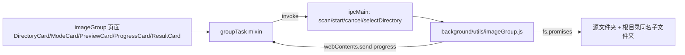

## 产品概述

将「图片按名称分组」功能改为就地整理：不再选择输出文件夹，直接把去掉扩展名后同名的图片归入源文件夹根目录下的同名文件夹。

## 核心功能

- 仅需选择源文件夹（唯一必填项），页面移除「输出文件夹」配置行
- 递归扫描源文件夹下所有子目录中的图片（jpg/jpeg/png/webp/gif/bmp/svg/avif/heic/heif/tif/tiff/ico）
- 按去扩展名后的文件名分组（忽略大小写），所有同名图片统一归入源根目录下同名文件夹，例如 `D:\图片\a.jpg`、`D:\图片\sub\a.png` → 均进入 `D:\图片\a\`
- 自动跳过已整理图片：图片所在文件夹名与自身去扩展名文件名相同（如 `a\a.jpg`）时视为已整理，扫描忽略，避免生成 `a\a\a.jpg` 嵌套
- 保留「单张图片也单独建文件夹」开关，默认关闭（关闭时仅归档出现 2 张及以上的同名分组）
- 保留「复制 / 移动」两种处理方式，移动模式执行前弹窗确认
- 目标文件同名冲突时自动追加 `_1`、`_2` 序号，不覆盖已有文件
- 扫描预览展示：图片总数、同名分组数、本次归档数，并提示已整理跳过的图片数量
- 执行过程展示进度条与当前分组，支持取消；结束后展示分组数、成功、失败、跳过及失败明细

## 技术栈

沿用现有项目栈，不新增依赖：

- Electron 主进程（Node.js fs.promises）负责扫描与文件操作
- IPC：`ipcMain.handle` + preload `contextBridge` 暴露的 `window.electronAPI.invoke/on/off`
- 渲染层：Vue 2 Options API + 自写 CSS（`src/views/imageGroup/`），hash 路由 `/image-group`

## 实现方案

**核心策略**：把「输出目录」这一维度整体删除，目标目录由 `output` 改为源目录本身，使 `targetDir = path.join(source, group.name)`；同时新增「已整理判定」避免重复整理产生嵌套目录。

**关键决策**

1. **目录解析简化**：`resolveDirectories(sourceDir, outputDir)` 替换为 `resolveSourceDirectory(sourceDir)`，仅做存在性/类型校验；删除 `isSubPath` 互不包含校验（目标目录必然在源内，原校验会误报）。
2. **已整理判定**：文件父目录 basename 与文件 basename 相同（忽略大小写）且父目录不等于源根目录时跳过。父目录为源根目录时不跳过，避免「源文件夹名与某张图片同名」被误判。该规则同时保证复制模式下再次扫描不会把 `a\a.jpg` 当作待处理文件，天然幂等。
3. **扫描返回值调整**：`collectImages` 由返回数组改为返回 `{ files, organizedSkipped }`，两处调用点（preview / run）同步更新；`organizedSkipped` 透传到预览与结果，供 UI 展示「已整理跳过」。
4. **复用既有能力**：`groupImages`、`resolveTargetPath`（`_1` 冲突序号）、`moveFile`（EXDEV 回退 copy+unlink）、`transferFile`、`onProgress` 节流（100ms）、`isCancelled` 取消机制全部保持不变。
5. **性能**：单次 BFS 遍历 O(n)，每组一次 `mkdir`（recursive），每文件一次 `access` 冲突检测；无重复遍历，无新增 N+1。已整理判定在扫描阶段完成，不额外遍历。
6. **UI 最小改动**：`DirectoryCard` 复用现有 `rows` 结构，仅减少一行；文案与新增统计做局部调整，不重构组件结构。

**边界与已知行为**

- 复制模式会在 `source\a\` 内生成副本，原图保留；再次执行会因冲突生成 `a_1.jpg`（不覆盖，符合预期）
- 移动模式后源目录下的空子目录不会自动删除（不主动清理用户目录，避免误删）
- 组名与源文件夹同名时目标仍为 `source\<组名>\`，不会与源根目录冲突
- 单张开关关闭时，单张图片计入 `skipped`

## 实现要点

- `background/utils/imageGroup.js` 中 `normalizeForCompare` 保留（用于已整理判定的大小写比较），`isSubPath` 变为无引用需一并删除，避免死代码
- `collectImages` 不再接收 `excludeDirs`（无输出目录可排除）
- IPC 层 `imageGroup:scan` / `imageGroup:start` 为参数透传，无需改动；前端停止传 `outputDir` 后旧字段自然消失
- 前端 `ready` 改为仅判断 `sourceDir`；`selectDirectory` 去掉 key 分支（保留入参以兼容 `DirectoryCard` 的 `@select`)
- 日志与错误：沿用「handler 内 try/catch 返回 `{ error }`」与单文件失败收集，不新增日志框架，失败明细上限 500 条保持

## 架构设计

无架构变化，仍为三层：渲染页面（Vue 组件 + mixin）→ IPC 通道 → 主进程文件工具模块。



## 目录结构

```
electron-temu/
├── background/
│   └── utils/
│       └── imageGroup.js            # [MODIFY] 核心逻辑：去掉输出目录，目标改为源根目录；新增已整理跳过与 organizedSkipped 统计；删除 isSubPath 与 excludeDirs
└── src/
    └── views/
        └── imageGroup/
            ├── index.vue            # [MODIFY] 顶部说明文案改为「归入源文件夹根目录下的同名文件夹」
            ├── mixins/
            │   └── groupTask.js     # [MODIFY] 删除 outputDir；ready 仅判断 sourceDir；scan/runTask 请求体去掉 outputDir；directoryRows 仅保留源目录一行
            └── components/
                ├── DirectoryCard.vue # [MODIFY] 卡片说明改为「递归扫描，同名图片归档到根目录下的同名文件夹」
                ├── ModeCard.vue      # [MODIFY] 移动模式说明由「移入输出目录」改为「移入同名文件夹」
                ├── PreviewCard.vue   # [MODIFY] 新增「已整理跳过」提示/指标，展示 preview.organizedSkipped
                └── ResultCard.vue    # [MODIFY] 结果文案由「输出目录」改为「源文件夹根目录下的同名文件夹」
```

## 关键接口

```js
// background/utils/imageGroup.js
async function collectImages(sourceDir) // → { files: string[], organizedSkipped: number }
async function previewImageGroups({ sourceDir }) // → { total, groupCount, duplicateCount, duplicateFiles, singleCount, organizedSkipped, duplicateGroups, duplicateGroupsTruncated }
async function runImageGroups({ sourceDir, mode, includeSingle, onProgress, isCancelled }) // → { total, groups, success, failed, skipped, organizedSkipped, cancelled, failures, failuresTruncated }
```