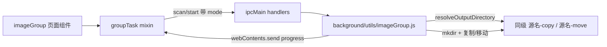

## 产品概述

把「图片按名称分组」的输出位置从「源文件夹内部」改为「与源文件夹同级的自动命名文件夹」：用户只需选择最外层源文件夹，复制模式输出到 `<源文件夹名>-copy`，移动模式输出到 `<源文件夹名>-move`，界面不再出现输出目录选择。

## 核心功能

- 仅选择源文件夹（唯一必填项），递归扫描其下所有子目录中的图片（jpg/jpeg/png/webp/gif/bmp/svg/avif/heic/heif/tif/tiff/ico）
- 按去扩展名后的文件名分组（忽略大小写），每组在输出根目录下建立同名子文件夹，例如 `C:\...\temu\XGT20261104708253` 复制后得到 `C:\...\temu\XGT20261104708253-copy\a\`、`...-copy\b\`
- 输出根目录按模式自动推导：复制 `-copy`、移动 `-move`；已存在则直接复用，重名文件自动追加 `_1`、`_2` 序号，不覆盖已有文件
- 保留「单张图片也单独建文件夹」开关，默认关闭（关闭时只归档出现 2 张及以上的同名分组）
- 保留「已在同名文件夹内则跳过」规则：源目录中 `a\a.jpg` 这类已整理图片扫描时忽略，避免重复搬运
- 扫描预览展示：图片总数、同名分组、本次归档、已整理跳过，并显示推导出的输出路径（存在时提示「已存在，将复用」）
- 执行过程展示进度与当前分组，支持取消；结束后展示分组数、成功、失败、跳过及失败明细，并显示实际输出路径

## 交互与视觉

- 目录配置卡片：只有一行源文件夹选择，下方以提示行显示输出位置（未选源文件夹时显示命名规则说明，扫描后显示真实路径），无选择按钮
- 切换复制/移动时，之前的扫描预览自动失效并提示重新扫描，避免用旧模式的统计执行
- 文案统一改为「同级 -copy / -move 文件夹」；移动模式仍保留确认弹窗

## 技术栈

沿用现有项目栈，不新增依赖：

- Electron 主进程（Node.js `fs.promises`）负责扫描与文件搬运
- IPC：`ipcMain.handle` + preload 暴露的 `window.electronAPI.invoke/on/off`
- 渲染层：Vue 2 Options API + 自写 CSS（`src/views/imageGroup/`），hash 路由 `/image-group`

## 实现方案

**核心策略**：把输出根目录从「源目录自身」改为「源目录的同级派生目录」，路径由模式决定，其余分组、冲突命名、复制/移动、进度与取消逻辑全部复用。

**关键决策**

1. **输出根目录推导**：新增 `resolveOutputDirectory(source, mode)`，返回 `path.join(path.dirname(source), basename + (mode === 'move' ? '-move' : '-copy'))`。源为磁盘根目录时 `path.basename` 为空，直接抛「源文件夹不能是磁盘根目录，请选择具体文件夹」，避免生成 `C:\-copy`。
2. **目录准备抽成一个函数**：`prepareOutputDirectory(outputDir, create)`，用 `stat` 判断存在性；存在但不是目录（同名文件占用）抛明确错误；`create=false`（预览）绝不创建目录，`create=true`（执行）才 `mkdir(recursive)`。预览与实际执行共用同一判断，避免预览通过但执行失败。
3. **预览需带模式**：`previewImageGroups({ sourceDir, mode })` 增加 `mode`（默认 copy），返回新增 `outputDir`、`outputExists`；`runImageGroups` 在开始前创建输出根目录并返回 `outputDir`，`targetDir = path.join(outputRoot, group.name)`。
4. **IPC 零改动**：`imageGroup:scan` / `imageGroup:start` 已是参数透传，前端补传 `mode` 即可；进度通道、取消标志、100ms 节流保持不变。
5. **跳过规则不变**：`isAlreadyOrganized` 保留；输出在源外，无需 `excludeDirs`，也天然避免「扫描到自己输出」的递归问题。
6. **行数控制**：`background/utils/imageGroup.js` 当前 298 行，新增约 17 行需同步压缩既有 JSDoc（5 处）并把 `transferFile` 改为表达式返回，控制在 300 行内。
7. **性能**：仍为单次 BFS `O(n)` 遍历；执行前一次 `stat` + 一次 `mkdir`，每组一次 `mkdir`，每文件一次冲突 `access`，无新增遍历与 N+1；移动模式目标与源同盘，`rename` 为原子操作。

**边界与已知行为**

- 复制模式输出目录已存在：复用并生成 `a_1.jpg`，不覆盖
- 移动模式输出目录已存在：同样复用，源文件移出后源目录空子目录不自动删除（不主动清理用户目录）
- 源文件夹名已带 `-copy`：再复制得到 `X-copy-copy`，符合「同级派生」语义
- 源文件夹位于磁盘根目录：扫描阶段即报错并提示选择具体文件夹

## 实现要点

- `mode` 非法值在 `previewImageGroups` 与 `runImageGroups` 中统一校验（`copy` / `move`），错误经 IPC `try/catch` 返回 `{ error }`
- 前端 `watch.mode` 由 `clearResult()` 改为 `resetPreview()`，确保输出路径与统计随模式刷新；`includeSingle` 仍只 `clearResult()`
- 前端新增 `outputHint` 计算属性（渲染层无 `path` 模块，用字符串切分推导），优先使用 `preview.outputDir`，未扫描时显示规则说明；磁盘根目录时返回空字符串，交由扫描报错
- `DirectoryCard.vue` 新增 `outputHint` prop，复用现有 `.igp-tip` 样式，无需改 CSS
- 失败明细上限 500、冲突序号、EXDEV 回退 copy+unlink 全部保持

## 架构设计

无架构变化，仍为三层，仅输出根目录的来源改变。



## 目录结构

```
electron-temu/
├── background/
│   └── utils/
│       └── imageGroup.js                  # [MODIFY] 新增 resolveOutputDirectory/prepareOutputDirectory；preview 接收 mode 并返回 outputDir、outputExists；run 创建输出根目录、targetDir 改为 outputRoot/组名、返回 outputDir；压缩注释控制在 300 行内
└── src/
    └── views/
        └── imageGroup/
            ├── index.vue                  # [MODIFY] 顶部副标题改为「输出到同级的 -copy / -move 文件夹」；移动确认弹窗文案改为移入同级 -move
            ├── mixins/
            │   └── groupTask.js           # [MODIFY] scan 请求补 mode；watch.mode 改为 resetPreview；新增 outputHint 计算属性；directoryRows 描述更新
            └── components/
                ├── DirectoryCard.vue      # [MODIFY] 新增 outputHint prop 并渲染提示行；卡片说明改为同级输出
                ├── ModeCard.vue           # [MODIFY] 复制说明改为输出到 <源名>-copy，移动说明改为输出到 <源名>-move
                ├── PreviewCard.vue        # [MODIFY] 展示 preview.outputDir，outputExists 时提示「已存在，将复用」
                └── ResultCard.vue         # [MODIFY] 展示 result.outputDir，标题与完成文案改为「同级文件夹」
```

## 关键接口

```js
// background/utils/imageGroup.js
function resolveOutputDirectory(source, mode) // → 绝对路径，源为磁盘根目录时抛错
async function prepareOutputDirectory(outputDir, create) // → 是否已存在；create=false 不创建
async function previewImageGroups({ sourceDir, mode })
// → { total, groupCount, duplicateCount, duplicateFiles, singleCount, organizedSkipped, outputDir, outputExists, duplicateGroups, duplicateGroupsTruncated }
async function runImageGroups({ sourceDir, mode, includeSingle, onProgress, isCancelled })
// → { total, groups, success, failed, skipped, organizedSkipped, outputDir, cancelled, failures, failuresTruncated }
```