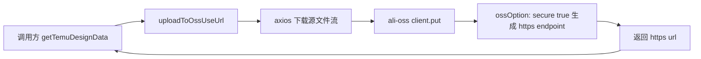

## 用户需求

修复 OSS 上传后返回的文件地址协议：此前为 `https`，当前变成了 `http`，需要恢复为 `https`。

## 产品概述

该工具用于把 Temu 素材（图片等）转存到自有 OSS（`google-plugin-file` bucket，杭州区域），上传成功后返回的 `url` 会被写入业务数据并用于后续展示/下载。当前返回的 `http` 地址在桌面端（Electron 渲染进程）属于非安全内容，易被拦截或加载失败。

## 核心功能

- OSS 客户端连接统一使用 HTTPS 协议，上传成功返回的 `result.url` 为 `https://` 开头。
- 上传逻辑、文件名生成、重试机制保持现状不变，仅修正协议，不改变 bucket、region、鉴权方式。
- 新增兜底保障：即使后续配置回退，对外返回的上传地址也强制为 `https`。
- 历史已上传对象无需迁移（同一对象 http/https 均可访问），仅影响新上传返回地址。

## 技术栈

- 运行环境：Electron 主进程（Node.js），CommonJS
- 对象存储 SDK：`ali-oss@6.23.0`（package.json 声明 `^6.23.0`）
- 网络请求：`axios`（已用于下载源文件流）
- 无需新增任何依赖

## 问题根因（已核实）

- `background/utils/oss/const.js` 的 `ossOption` 未配置 `secure`。
- `node_modules/ali-oss/lib/common/client/initOptions.js` 默认 `secure: false`。
- 仅传 `region` 时调用 `setRegion(region, internal, secure)`，`node_modules/ali-oss/lib/common/utils/setRegion.js` 中 `const protocol = secure ? 'https://' : 'http://'`，endpoint 被拼成 `http://oss-cn-hangzhou.aliyuncs.com`，`client.put()` 返回的 `result.url` 因此为 http。
- `background/utils/oss/index.js` 直接透传 `client.put()` 结果，调用方（`background/express/controllers/automation/process/utils/getTemuDesignData.js` 第 34-36 行、第 255-257 行）直接使用 `res.url`，未做协议归一化。
- 全仓 `background/` 内无其他 `endpoint` / `secure` 配置，改动点唯一、影响面可控。

## 实现方案

1. 根因修复：在 `ossOption` 中显式增加 `secure: true`，使 endpoint 由 SDK 生成 `https://oss-cn-hangzhou.aliyuncs.com`，`client.put()` 返回的 `url` 即为 https。该方式比硬编码 `endpoint` 更契合现有「只配 region」的写法，区域切换时无需同步改 endpoint。
2. 兜底加固：在 `background/utils/oss/index.js` 的 `uploadToOssUseUrl` 返回前，将 `result.url` 的 `http:` 前缀归一化为 `https:`（仅在 `url` 存在时处理，使用不可变方式返回新对象，避免修改 SDK 结果结构）。
3. 兼容性：`authorizationV4: true` 与 `secure: true` 无冲突；已上传对象无需迁移；调用方签名与返回结构不变，无破坏性变更。

## 架构设计

改动局限在 OSS 工具层，数据流不变：



## 目录结构

```
electron-temu/
└── background/
    └── utils/
        └── oss/
            ├── const.js  # [MODIFY] ossOption 增加 secure: true（根因修复）。保持 region/bucket/AK/SK/authorizationV4 不变，补充中文注释说明该字段控制 http/https 协议。
            └── index.js  # [MODIFY] uploadToOssUseUrl 返回前对 result.url 做 http -> https 归一化兜底。仅在 url 存在时替换前缀，返回新对象，不修改 SDK 原始返回；保持 try/catch 与错误信息不变。
```

## 实施要点

- 只改协议相关配置，不动 bucket、region、AK/SK、文件名生成（`getRandom` / `getFillFileName`）与重试逻辑，避免扩大影响面。
- `index.js` 兜底需防御 `result` 为空或 `url` 非字符串的情况，避免引入新的 TypeError。
- 不新增依赖、不引入新抽象；不改动调用方 `getTemuDesignData.js`。
- 验证方式：上传一张素材，确认返回 `url` 以 `https://` 开头且可正常访问；同时确认上传成功率与耗时无明显变化。